# Pixel Mapper

Pixel Mapper finds the position of each pixel on a light prop, for example a wrapped tree or a
bush. Then it makes a model file for xLights.

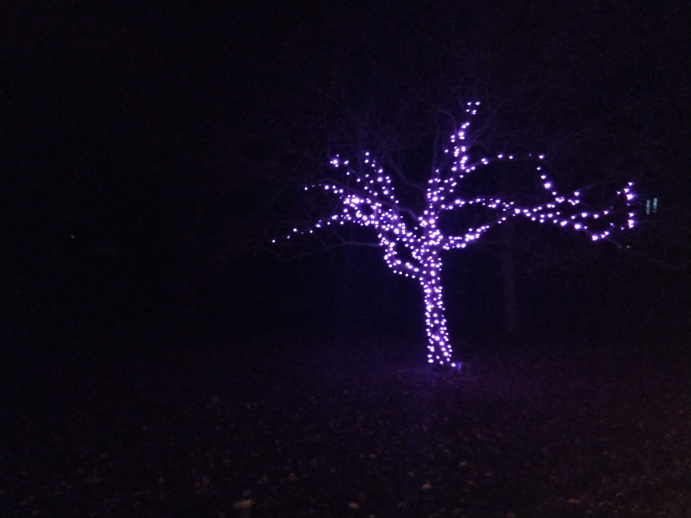

*A wrapped tree (left) and its 3D model in xLights (right).*

## About this version

This repository started as a set of Python scripts. You edited settings at the top of each
script and ran the scripts one after the other. This app is a new user interface that does
the same job as those scripts. An AI coding assistant wrote the app.

- The app is in the root folder of the repository.
- The original scripts are in the [`original_scripts`](original_scripts) folder. Their guide is
  [`original_scripts/README.md`](original_scripts/README.md). The app does not use or change
  these scripts.
- The app does these jobs of the original scripts: camera alignment
  (`camera_align.py`), photo capture (`pixel_gather_images*.py`), pixel detection
  (`pixel_automap*.py`), file conversion (`JSONtoCSV.py`), the 3D calculation
  (`calc_points.py`), and the xLights export (`calc_points.py`, `csv_to_xlights_2d.py`).
- The app also corrects some errors in the original scripts. Refer to
  [Changes from the original scripts](#changes-from-the-original-scripts).

Folders in the repository:

- `app/`: The program that runs on the Pi or the computer.
- `static/`: The screens that show in the browser.
- `tests/`: The tests and the demo project.
- `docs/images/`: The screenshots in this guide.
- `images/`: Photos and videos of the original project.
- `original_scripts/`: The original scripts and their guide.

Test the app on your props before you use it for a show. An AI wrote the code, and the app
has had no tests with a real camera and controller yet.

## What the app does

The app runs in a web browser. The same app runs on a Raspberry Pi and on a Windows computer.

A typical use:

1. At the prop, a Raspberry Pi with a USB camera runs the app. You use a phone or a laptop on
   the same WiFi network to control it. The app turns on each pixel and takes one photo of it.
2. Later, you copy the project folder to a computer with a larger screen. On that computer, the
   app finds the pixels in the photos. You correct the errors and make the model.

You can also do all of the steps on one computer.

About the pictures in this guide:

- The screenshots come from the demo project. Refer to [Tests and demo](#tests-and-demo).
- On the Align and Capture screenshots, the camera image is a photo from the original project.
- The photos and videos from the `images` folder show the original project with the original
  scripts. The steps are the same in the app.

## Contents

- [About this version](#about-this-version)
- [What the app does](#what-the-app-does)
- [Words in this guide](#words-in-this-guide)
- [Equipment](#equipment)
- [Install the app](#install-the-app)
- [Start the app](#start-the-app)
- [Order of work](#order-of-work)
- [Top bar](#top-bar)
- [Tab 1: Project](#tab-1-project)
- [Tab 2: Lights](#tab-2-lights)
- [Tab 3: Align](#tab-3-align)
- [Tab 4: Capture](#tab-4-capture)
- [Tab 5: Review](#tab-5-review)
- [Tab 6: Model](#tab-6-model)
- [Problems and solutions](#problems-and-solutions)
- [Project folder](#project-folder)
- [Changes from the original scripts](#changes-from-the-original-scripts)
- [Tests and demo](#tests-and-demo)
- [Limits](#limits)

## Words in this guide

- **Project**: A folder that holds one or more props. For example, make one project for each
  year.
- **Prop**: One object that you map, for example the tree or one bush. Each prop has its own
  settings, photos, and model.
- **3D prop**: A prop that you photograph from three camera spots. Use 3D for a tree.
- **2D prop**: A prop that you photograph from one camera spot. Use 2D for a flat prop or a
  small prop, for example a bush.
- **Camera spot**: A position for the camera. A 3D prop has camera spots 1, 2, and 3. The
  three spots make a triangle with three equal sides. The prop is at the center of the triangle.
- **Pixel number**: The app counts pixels from 0. Pixel 0 is the first pixel on the string.
  In xLights, pixel 0 is node 1.
- **Universe**: A block of up to 512 channels that the controller receives. Each pixel uses
  3 channels (red, green, and blue).
- **Controller**: The device that sends power and data to the pixels, for example a Falcon
  controller or FPP. The app sends sACN (E1.31) data to the controller.
- **Mask**: An outline that you draw around the prop on the camera image. The app ignores
  light outside the mask.
- **Detection**: The step where the app finds the lit pixel in each photo.
- **Mark**: The result for one pixel in the photos from one camera spot. A mark has a status:
  found, manual, ambiguous, not found, or hidden. Refer to [Tab 5: Review](#tab-5-review).
- **Job**: A long task that runs in the background, for example a capture or a detection.
- **Click**: On a phone or a tablet, tap.

## Equipment

- A USB webcam. The app does not support the Raspberry Pi camera module.
- A tripod or other stable support for the camera.
- For a 3D prop: three markers for the camera spots, for example stakes or small lights.
- A tape measure.
- A pixel controller on the same network as the computer that runs the app.
- For work away from the house: a Raspberry Pi with a battery.

## Install the app

You need Python 3.10 or newer.

### Windows

Do these steps in PowerShell, in the root folder of the repository.

1. Make the virtual environment outside Google Drive. This stops Google Drive from syncing
   thousands of small files.

   ```powershell
   python -m venv $env:LOCALAPPDATA\pixel_mapper_venv
   ```

2. Install the necessary packages.

   ```powershell
   & $env:LOCALAPPDATA\pixel_mapper_venv\Scripts\pip install -r requirements.txt
   ```

### Raspberry Pi OS (64-bit)

Do these steps in a terminal, in the root folder of the repository.

```bash
sudo apt install python3-venv
python3 -m venv ~/pm-venv
~/pm-venv/bin/pip install -r requirements.txt
```

If `opencv-python-headless` does not install (this can occur on 32-bit Raspberry Pi OS):

1. Install OpenCV from Raspberry Pi OS: `sudo apt install python3-opencv`.
2. Delete the `~/pm-venv` folder.
3. Make the virtual environment again with this command:
   `python3 -m venv --system-site-packages ~/pm-venv`.
4. Do the `pip install` command again.

## Start the app

Do this command in the root folder of the repository.

Windows:

```powershell
& $env:LOCALAPPDATA\pixel_mapper_venv\Scripts\python run.py
```

Raspberry Pi:

```bash
~/pm-venv/bin/python run.py
```

The app shows an address, for example `http://192.168.1.50:8000`. Open this address in a
browser on a device on the same network. The Pi does not need a monitor.

To stop the app, push Ctrl+C in the terminal.

### Start options

Add these options after `run.py`:

- `--projects <folder>`: The folder that holds your projects. The default is
  the `projects` folder in the repository. Put the folder in quotation marks if the name has spaces. Example:
  `--projects "G:/My Drive/House Stuff/Christmas Snowflake LEDs/data/mapper"`.
- `--port <number>`: The network port. The default is `8000`. Change it if a different program
  uses port 8000. Example: `--port 8080`.
- `--host <address>`: The network address where the app accepts connections. The default is
  `0.0.0.0`, which is all networks. Use `127.0.0.1` to permit connections only from the same
  computer.

### If there is no WiFi at the prop

The Pi can make its own WiFi network:

1. On the Pi, do this command:
   `sudo nmcli device wifi hotspot ssid pixelmapper password <password>`.
2. Connect your phone to the `pixelmapper` network.
3. Open `http://10.42.0.1:8000`.

The Pi must also connect to the pixel controller. Thus, the controller must join the
`pixelmapper` network, or the Pi must stay on the home network.

### Start the app automatically on the Pi

1. Make the file `/etc/systemd/system/pixelmapper.service` with this text. Change the user and
   the folders if they are different on your Pi.

   ```ini
   [Unit]
   Description=Pixel Mapper
   After=network-online.target

   [Service]
   User=pi
   WorkingDirectory=/home/pi/pixel_mapper
   ExecStart=/home/pi/pm-venv/bin/python run.py
   Restart=on-failure

   [Install]
   WantedBy=multi-user.target
   ```

2. Do this command: `sudo systemctl enable --now pixelmapper`.

## Order of work

Do these steps for each prop. For a 3D prop, do steps 3 and 4 at each of the three camera
spots. Then do step 5 for each camera spot.

1. **Project** tab: Make a project and a prop. Enter the prop settings. Open the camera.
2. **Lights** tab: Make sure that the controller turns on the pixels.
3. **Align** tab: Aim the camera. Save the camera spot.
4. **Capture** tab: Draw the mask. Capture one photo for each pixel.
5. **Review** tab: Let the app find the pixels in the photos. Correct the errors.
6. **Model** tab: Make the model. Download the `.xmodel` file.

Steps 1 to 4 need the camera and the controller. Steps 5 and 6 need only the project folder.
You can do steps 5 and 6 on a different computer.

For a 3D prop, go around the prop counter-clockwise when you look down from above. Camera
spot 2 is on your right when you stand at camera spot 1 and look at the prop.

## Top bar

The top bar is always at the top of the screen. The browser remembers the last project, prop,
and tab that you used.

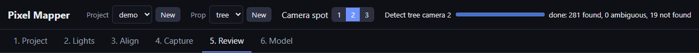

*The top bar. Camera spot 2 is selected. The job bar shows the result of a detection.*

- **Project**: Select the project. The list shows all projects in the projects folder.
- **New** (next to Project): Makes a new project.
  1. Click **New**.
  2. Type a name, for example `2026`.
  3. Click **OK**.
- **Prop**: Select the prop. The list shows all props in the selected project.
- **New** (next to Prop): Makes a new prop in the selected project.
  1. Click **New**.
  2. Type a name, for example `tree` or `bush1`.
  3. In **Mode**, select **3D, three camera spots** or **2D, one camera spot**.
  4. Click **OK**. The app opens the Project tab for the new prop.

  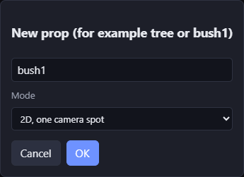

- **Camera spot**: Select camera spot 1, 2, or 3. The Align, Capture, and Review tabs use the
  selected camera spot. A 2D prop has only camera spot 1.
- **Job bar**: Shows when a capture or a detection runs, and for 20 seconds after it stops. It
  shows the job name, a progress bar, and a message. During a capture, the message shows the
  time that remains.
- **Cancel** (in the job bar): Stops the job. If you stop a capture, the app keeps the photos
  that it took. To continue later, use **Resume** on the Capture tab.
- **Tabs 1 to 6**: Open the screen for each step. If the project has no prop, only the Project
  tab shows.

Names for projects and props:

- Use 1 to 64 characters.
- Use letters, numbers, spaces, dots (.), dashes (-), and underscores (_).
- Start with a letter or a number.

A job continues if you close the browser. Open the address again to see the progress.

## Tab 1: Project

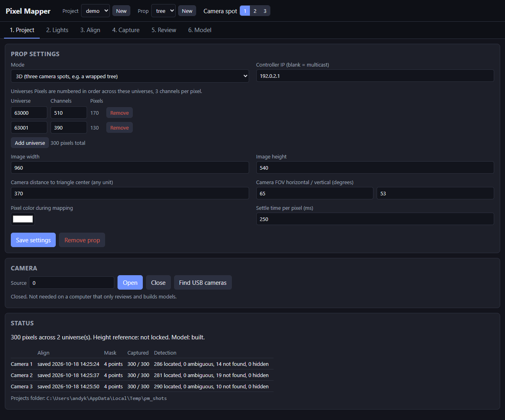

*The Project tab for the demo tree: a 3D prop with 300 pixels in two universes.*

### Prop settings

The app does not save changes in this section until you click **Save settings**.

- **Mode**: The type of prop.
  - **3D**: Three camera spots. Use this for a tree or other round prop.
  - **2D**: One camera spot. Use this for a flat prop or a small prop.

  Select the mode before you capture photos. When you select 2D, the camera distance and the
  camera FOV fields go away, because 2D does not use them.

- **Controller IP (blank = multicast)**: The IP address of the pixel controller, for example
  `192.168.1.143`.
  - If you type an address, the app sends the light data only to that controller (unicast).
  - If you leave it blank, the app sends the light data to all devices on the network that
    listen to these universes (multicast).

  Unicast is more reliable. Use the controller IP if you know it.

- **Universes**: One row for each universe that the prop uses. Put the rows in the same order
  as the string. Pixel numbers continue from one row to the next row. Example: if row 1 has
  510 channels (170 pixels), the first pixel of row 2 is pixel 170.
  - **Universe**: The universe number, from 1 to 63999. Use the same number as the controller.
  - **Channels**: The number of channels that the prop uses in this universe, from 3 to 512.
    Each pixel uses 3 channels. Example: for 170 pixels, type 510.
  - **Pixels**: The number of pixels in this universe. The app calculates this value. You
    cannot change it.
  - **Remove**: Removes the row.
  - **Add universe**: Adds a row. The new row has the next universe number and 510 channels.
    Change the values if necessary.
  - The line under the table shows the total number of pixels.

  The default is one universe, number 2000, with 510 channels.

- **Image width** and **Image height**: The camera image size in image pixels. The default is
  1920 x 1080. The minimum is 320 x 240.
  - The app asks the camera for this size when you click **Open** in the Camera section.
  - If the camera cannot use this size, it uses a different size. The camera status line shows
    the size that the camera uses.
  - A larger size gives more accurate positions. But the photos are larger, and the capture is
    slower.
  - Click **Save settings** before you open the camera.

- **Camera distance to triangle center (any unit)**: 3D only. The distance from each camera
  spot to the center of the prop. The default is 370.
  - Measure to the camera lens.
  - All three camera spots must have the same distance.
  - Use a unit that you like, for example centimeters or inches. The model positions use the
    same unit. The **Scale factor** on the Model tab also uses this unit.
  - To set out the triangle, measure the distance between two camera spots. It must be
    1.732 x the camera distance. Example: for a distance of 370 cm, put the camera spots
    641 cm apart.

- **Camera FOV horizontal / vertical (degrees)**: 3D only. The angle that the camera sees.
  The first value is from left to right. The second value is from top to bottom. The default
  is 65 / 53. Get the values from the camera specifications.
  - The app gets a more accurate horizontal angle from the yellow lines on the Align tab.
  - The app always compares the vertical value with the horizontal value to calculate the
    height of each pixel. If the two values do not agree with the image shape, the model is
    too tall or too short.
  - Many webcams cut the top and bottom of the image in 16:9 sizes, for example 1920 x 1080.
    For a 65 degree horizontal angle, the vertical angle is approximately 51 degrees at 4:3
    and 39 degrees at 16:9.

- **Pixel color during mapping**: The color of the lit pixels in all steps. The default is
  white. If the pixels look too bright in the photos, select a darker color, for example gray.

- **Settle time per pixel (ms)**: The time that the capture waits after it turns on a pixel,
  before it takes the photo. The default is 250 ms.
  - Increase the value if photos show the wrong pixel or no pixel. This occurs when the
    controller or the camera is slow.
  - Decrease the value to make the capture faster.
  - The total capture time is approximately (settle time + 0.1 s) x the number of pixels.
    Example: 500 pixels at 250 ms take approximately 3 minutes.

- **Save settings**: Saves all values in this section.
- **Remove prop**: Removes the prop from the project. The app asks you to confirm. The prop
  folder and its photos stay on the disk.

### Camera

You do not need the camera on a computer that you use only for review and the model.

- **Source**: The camera to use.
  - For a USB camera, type its number. The first camera is `0`, the next is `1`.
  - For a network camera, type its stream address, for example
    `http://192.168.1.60:8080/video`.

  The app remembers the source on each computer.

- **Open**: Starts the camera. The app uses the image size from the prop settings.
- **Close**: Stops the camera. You cannot close the camera during a capture.
- **Find USB cameras**: Looks for USB cameras. Then it puts the first camera number in
  **Source**. Close the camera before you use this button.
- The status line shows if the camera is open, its source, and its image size. If the camera
  uses a size that is different from the prop settings, the line shows both sizes.

### Status

This section shows the progress of the prop. You cannot change the values here.

- The total number of pixels and universes.
- The pixels for the height reference, if you locked them on the Align tab.
- If the model is built.
- One row for each camera spot:
  - **Align**: The date and time when you saved the camera spot.
  - **Mask**: The number of points in the mask.
  - **Captured**: The number of photos. "Incomplete" means that the capture did not finish.
  - **Detection**: The number of pixels in each status.
- The location of the projects folder.

## Tab 2: Lights

Use this tab to make sure that the controller receives the light data. Do this before you
align the camera.

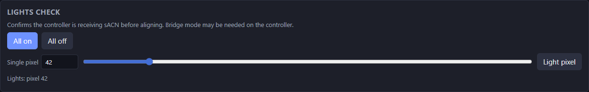

*Pixel 42 is on. The line at the bottom shows the last command.*

- **All on**: Turns on all pixels of the prop in the mapping color.
- **All off**: Turns off all pixels of the prop.
- **Single pixel**: Type a pixel number. Then push Enter or click **Light pixel**. Only that
  pixel comes on.
- **Slider**: Move the slider to select a pixel. The pixel comes on as you move the slider.
- **Light pixel**: Turns on the pixel in **Single pixel**.
- The line under the controls shows the last command. If the app cannot send the data, the
  line shows the error.

The app sends the light data again each second. Thus, the controller does not turn off the
pixels during alignment.

If no pixels come on:

1. Make sure that the controller IP and the universes are correct on the Project tab.
2. Make sure that the controller accepts sACN (E1.31). Some controllers, for example FPP, must
   be in bridge mode.
3. If **Controller IP** is blank, type the IP. Some networks do not send multicast data.

You cannot use the lights during a capture.

## Tab 3: Align

### Set out the camera spots (3D prop)

Do this procedure one time for each prop, before you align the camera.

1. Find the camera distance. Put the camera near the prop. Move it back until the full prop is
   in the image. Keep the distance as small as possible.
2. Calculate the side length of the triangle: camera distance x 1.732.
3. Cut three strings to the side length.
4. Pull the three strings tight to make a triangle around the prop. The prop must be at the
   center.
5. Mark each corner on the ground, for example with spray paint. These are the camera spots.
6. Enter the camera distance on the Project tab.

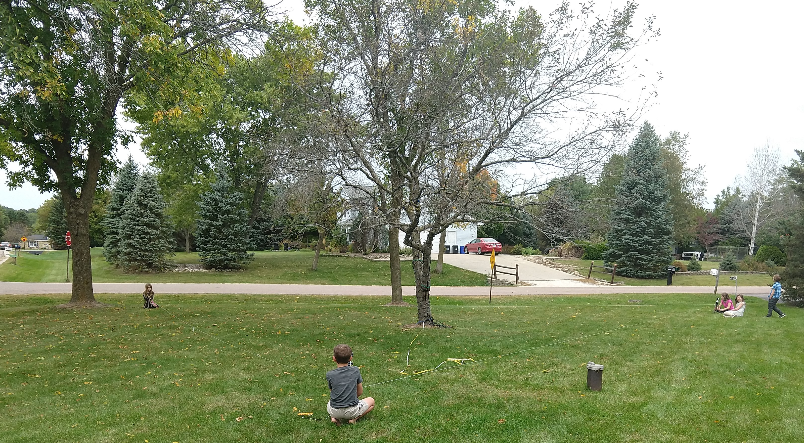

*Three strings of equal length make the triangle around the tree.*

### Align screen

The live camera image shows on the left. If the camera is closed, click **Open camera**.

The image shows these lines:

- **Blue vertical line**: The center of the image.
- **Blue horizontal line**: The height reference.
- **Two yellow lines**: The directions to the other two camera spots.

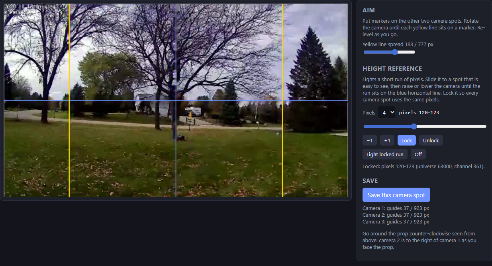

*The yellow lines are on the markers at the other two camera spots. Pixels 120 to 123 are
locked as the height reference.*

### Aim the camera (3D prop)

Use a tripod with a bubble level. A small movement of the camera can change the level. Make
sure that the camera is level after each adjustment.

1. Put markers on the ground at the other two camera spots.  Flashlights pointed at the camera work well at night.  
2. Put the camera at the selected camera spot. Make sure that it is level.
3. Turn the camera until the two markers are at equal distances from the blue vertical line.
4. Move the **Yellow line spread** slider until each yellow line is on a marker.
5. Do steps 3 and 4 again until both lines are on the markers. The blue vertical line is
   then on the center of the prop.

From one corner of the triangle, the other two corners are 60 degrees apart. Thus, the
yellow lines tell the app how many degrees each image pixel covers.

[This video](images/AlignmentHorizontal.mp4) shows the same procedure with the original script.
Soccer balls are the markers.

### Set the height (3D prop)

Do this procedure at camera spot 1 first.  We'll illuminate a few pixels on the prop to use as our vertical reference and center the camera's vertical field of view on those pixels at each camera location as we proceed.  

1. In **Pixels**, select how many pixels to turn on (3, 4, or 5).
2. Move the slider until the lit pixels are easy to see from all camera spots.
3. Raise or lower the camera until the lit pixels are on the blue horizontal line.
4. Click **Lock**.

At camera spots 2 and 3:

1. Click **Light locked run**.
2. Raise or lower the camera until the same pixels are on the blue horizontal line.

### Align controls

- **Yellow line spread**: Moves the two yellow lines closer together or farther apart. The
  numbers show the position of each line in image pixels.
- **Pixels**: The number of pixels in the height reference: 3, 4, or 5. The default is 4.
- The text next to **Pixels** shows the pixel numbers that are on.
- **Slider**: Moves the lit pixels along the string. The pixels change as you move the slider.
- **−1** and **+1**: Move the lit pixels one pixel back or forward.
- **Lock**: Saves the lit pixels as the height reference for all camera spots.
- **Unlock**: Removes the saved height reference.
- **Light locked run**: Turns on the saved height reference pixels. It also moves the slider
  to them.
- **Off**: Turns off all pixels.
- The text under the buttons shows the locked pixels, with their universe and channel.
- **Save this camera spot**: Saves the alignment for the selected camera spot. Click it after
  you aim the camera and set the height. The app saves:
  - The positions of the yellow lines.
  - The locked height reference.
  - A photo of the camera image (`align.jpg`).
  - The camera image size.
- The text under **Save this camera spot** shows the saved values for each camera spot.

### 2D prop

For a 2D prop, aim the camera so that the full prop is in the image. The yellow lines and the
height reference are not necessary. You can save the camera spot to keep a photo of the setup.

## Tab 4: Capture

The live camera image shows on the left. If the camera is closed, click **Open camera**.

### Draw the mask

The mask tells the app where the prop is in the image. During detection, the app ignores
light outside the mask, for example street lights, windows, and other props. A mask is
optional. Without a mask, the app uses the full image.

1. Click **All on**.
2. Click points around the prop on the camera image. Click the points in order around the
   prop. Put the points a small distance outside the pixels.
3. Click **Save mask**.

A yellow outline shows a mask that is not saved. A blue outline shows a saved mask.

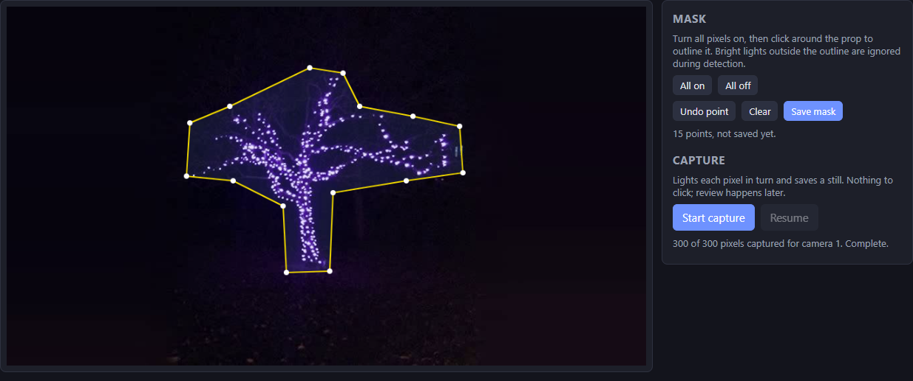

*A mask with 15 points around the lit tree. The mask is yellow because it is not saved yet.*

[This video](images/DrawPolygon.mp4) shows how to draw the outline with the original script. In
the app, you click **Save mask** instead of the right mouse button.

Draw the mask at the camera spot. You need the live camera image to draw the mask.

### Mask controls

- **All on**: Turns on all pixels. This shows the shape of the prop.
- **All off**: Turns off all pixels.
- **Undo point**: Removes the last point.
- **Clear**: Removes all points. To remove a saved mask, click **Clear** and then
  **Save mask**.
- **Save mask**: Saves the mask for the selected camera spot. A mask must have 3 or more
  points.
- The text under the buttons shows the number of points and if the mask is saved.

### Capture the photos

1. Make sure that the camera does not move during the capture.
2. Make sure that no other lights change near the prop.
3. Click **Start capture**.
4. Look at the job bar for the progress.

The capture does these steps automatically:

1. Turns on all pixels and waits for the camera to adjust.
2. Locks the camera brightness, if the camera permits it.
3. Takes a photo with all pixels on (`all_on.jpg`).
4. Takes a photo with all pixels off (`all_off.jpg`).
5. Turns on each pixel, one at a time, and takes one photo of each pixel.
6. Turns off all pixels.

### Capture controls

- **Start capture**: Starts a new capture for the selected camera spot. If photos are already
  there, the app asks you to confirm. Then it deletes the old photos.
- **Resume**: Continues a capture that stopped. The app keeps the photos that it took and
  captures only the missing pixels. This button is not available if there are no photos or if
  all photos are there.
- The text under the buttons shows how many pixels have a photo. It also tells you if the
  camera did not lock its brightness. In that case, use **Neighboring frames** on the Review
  tab.

You need the camera open on the Project tab before you start a capture.

## Tab 5: Review

On this tab, the app finds the lit pixel in each photo. Then you correct the errors. A large
screen and a mouse make this step easier.

Do these steps for each camera spot:

1. Select the camera spot in the top bar.
2. Click **Run detection**.
3. When the job is complete, look at each pixel in the **Needs review** list.
4. For each pixel, do one of these:
   - If the circle is on the correct pixel, push A.
   - If the circle is on the wrong position, click the correct pixel in the image.
   - If you cannot see the pixel from this camera spot, push H.

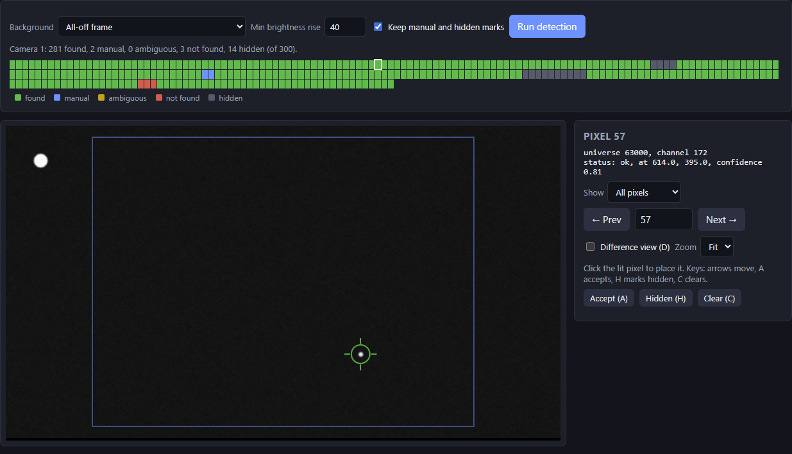

*Pixel 57 is found. The green circle shows its position. The blue rectangle is the mask. The
app ignores the bright light at the top left because it is outside the mask.*

### Detection controls

- **Background**: The photo that the app compares with each pixel photo.
  - **All-off frame**: The photo with all pixels off. This is the default. Use it if the
    camera brightness and the other lights did not change during the capture.
  - **Neighboring frames (use if exposure drifted)**: A mix of the photos before and after each
    pixel. Use it if the camera brightness changed, or if other lights changed during the
    capture. The app selects this option automatically if the camera did not lock its
    brightness.
- **Min brightness rise**: How much brighter a spot must be than the background to count as a
  lit pixel. The scale is 0 to 255. The range is 5 to 250. The default is 40.
  - Decrease the value (for example to 20) if the app does not find dim pixels.
  - Increase the value (for example to 60) if the app finds reflections or noise.
- **Keep manual and hidden marks**: If selected, a new detection does not change the pixels
  that you clicked or marked hidden. This is the default. Clear it to start again from zero.
- **Run detection**: Starts the detection for the selected camera spot. The job bar shows the
  progress.
- The line under the controls shows the number of pixels in each status.

### Pixel strip

The strip shows one small box for each pixel, in order. Click a box to show that pixel. A
white border shows the current pixel.

| Color | Status | Meaning |
|---|---|---|
| Green | Found | The app found one clear lit spot. |
| Blue | Manual | You clicked the position. |
| Orange | Ambiguous | The app found two or more bright spots. It is not sure which spot is correct. |
| Red | Not found | The app did not find a lit spot. |
| Gray | Hidden | You marked the pixel as not visible from this camera spot. |
| Dark | No photo | The capture did not take a photo of this pixel. |

The model uses only found and manual pixels. To use ambiguous pixels without review, select
**Use ambiguous detections** on the Model tab.

### Photo view

The photo of the current pixel shows on the left.

- A circle shows the position of the pixel. Its color agrees with the status colors above.
- A faint blue outline shows the mask.
- **Click the photo**: Puts the pixel at the position that you click. The status changes to
  manual. Then the app shows the next pixel in the list.

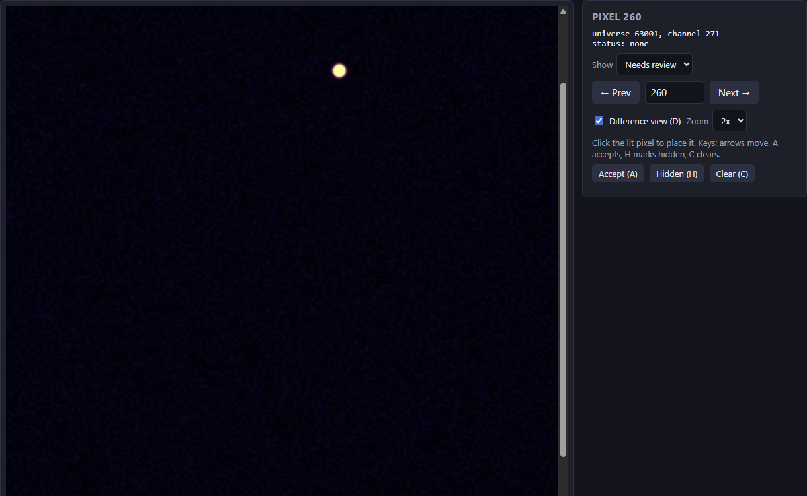

*Pixel 260 is not found. Difference view and 2x zoom show the lit pixel as a bright dot. Click
the dot to put the pixel there.*

### Pixel controls

- The title shows the pixel number.
- The text under the title shows:
  - The universe and channel of the pixel.
  - The status.
  - The position in image pixels, if there is one.
  - The confidence, for found and ambiguous pixels. The scale is 0 to 1. A higher value means
    that the app is more sure.
  - "frame not captured", if the pixel has no photo.
- **Show**: The list of pixels that **Prev** and **Next** go through.
  - **Needs review**: Ambiguous and not found pixels that have a photo. This is the default.
  - **All pixels**: All pixels.
  - **Ambiguous**, **Not found**, **Manual**, **Hidden**: Only the pixels with that status.
- **← Prev**: Shows the previous pixel in the list.
- **Next →**: Shows the next pixel in the list.
- **Number box** (between Prev and Next): Type a pixel number and push Enter to show it.
- **Difference view (D)**: Shows only the change from the background. The lit pixel shows as
  a bright spot on a dark image. This makes dim pixels easier to see.
- **Zoom**: The size of the photo.
  - **Fit**: The full photo fits the screen width.
  - **1x**, **2x**, **4x**: Bigger views. The view moves to the pixel position or to the
    center of the mask. Use the scroll bars to move the view.
- **Accept (A)**: Changes an ambiguous pixel to found. The app keeps the position of the
  circle. Then it shows the next pixel in the list. This does not work on a pixel without a
  circle. Click the photo instead.
- **Hidden (H)**: Marks the pixel as not visible from this camera spot. Then it shows the next
  pixel in the list. For a 3D prop, the app uses the other camera spots for this pixel.
- **Clear (C)**: Removes the position. The status changes to not found. The app stays on this
  pixel.

When **Show** is **All pixels**, the app stays on the same pixel after you click, accept, or
hide.

### Keys

The keys work on the Review tab when the cursor is not in a text box.

| Key | Action |
|---|---|
| Right arrow | Next pixel in the list |
| Left arrow | Previous pixel in the list |
| A | Accept |
| H | Hidden |
| C | Clear |
| D | Difference view on or off |

For a 3D prop, the app needs each pixel in the photos from two or more camera spots. A pixel
that is hidden from one camera spot is satisfactory if the other two camera spots see it.

## Tab 6: Model

On this tab, the app calculates the pixel positions and makes the model files. Do detection
for all camera spots before you build the model.

### Model settings

The app saves these settings with the prop when you click **Build model**.

- **Fill short gaps only**: Controls how the app fills missing pixels. This is selected by
  default.
  - Selected: The app fills only a row of missing pixels that is **Max gap** pixels long or
    shorter. The row must have known pixels on both sides. The app puts the missing pixels on a
    straight line between the known pixels.
  - Not selected: The app fills all missing pixels. At the start and the end of the string, it
    uses the position of the nearest known pixel. This can put pixels in the wrong position.

  The model does not include pixels that the app did not fill. The other pixels keep their
  correct channels in xLights.

- **Max gap**: The longest row of missing pixels that the app fills. The default is 5. This
  field is available only when **Fill short gaps only** is selected.

- **Size by**: How the app sets the size of the xLights grid. xLights puts each pixel in one
  cell of a grid. More cells give more accurate positions, but the file is larger.
  - **Grid cells on longest side**: You set the number of cells on the longest side of the
    model. This is the default.
  - **Scale factor (units per cell)**: You set the size of each cell. This is the same as
    `xLights_output_scale_factor` in the original scripts.

- **Grid cells**: Shows when **Size by** is **Grid cells on longest side**. The number of
  cells on the longest side of the model. The minimum is 10.
  - Leave it blank to let the app find the size. This is the default, and it is correct for
    most props.
  - The app measures the distance from each pixel to the nearest pixel. Then it makes the
    cells small enough that nearby pixels go in different cells.
  - The app does not use more than 300 cells on a side, or more than 2 million cells in
    total. Larger models make xLights slow. It does not use fewer than 120 cells (3D) or
    200 cells (2D) on the longest side.
  - The summary shows the cell size that the app used, how many pixels it moved to a free
    cell, and the number of nodes in the `.xmodel`. The node count in xLights must be the same.
  - If the model in xLights does not look correct, try a smaller scale factor.

- **Scale factor**: Shows when **Size by** is **Scale factor (units per cell)**. The size of
  one cell in model units. Use a value greater than 0.
  - For a 3D prop, the unit is the unit of the camera distance.
  - For a 2D prop, the unit is one image pixel.
  - A larger value gives a smaller file.
  - the original scripts used 1.7 for the tree and 0.5 for the bushes. These values give the same
    grid only if you use the same distance unit as the original scripts.

- **Min ray angle (deg)**: 3D only. The default is 15.
  - Each pair of camera spots gives one estimate of the position of a pixel. The app draws a
    line from each camera to the pixel. The two lines cross at the pixel.
  - If the two lines cross at an angle smaller than this value, the estimate is not accurate.
    The app does not use that pair.
  - With three equal sides, most angles are near 60 degrees. If many pairs are rejected, the
    problem is usually incorrect marks, not this value.

- **Disagreement limit (fraction of distance)**: 3D only. The default is 0.08.
  - A pixel that all three camera spots see has three estimates. If one estimate is farther
    from the other two than this limit, the app does not use it.
  - The limit is a fraction of the camera distance. Example: 0.08 x 370 = 30 units.
  - Decrease the value to remove more bad estimates. Increase the value if the summary shows
    many pixels where the pairs disagree.

- **Use ambiguous detections**: If selected, the model also uses ambiguous pixels. This is not
  selected by default. It is better to review ambiguous pixels on the Review tab.

- **Build model**: Calculates the positions and writes the model files. It uses the current
  marks from the Review tab.

### Model summary

After the build, the app shows:

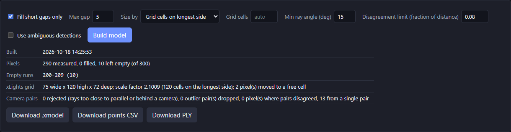

*The model settings, the summary, and the download buttons. Pixels 200 to 209 are empty
because no camera spot saw them. This row is longer than Max gap, so the app did not fill it.*

- **Built**: The date and time of the build.
- **Pixels**: The number of pixels that the app measured, filled, and left empty.
- **Empty runs**: The pixel numbers of each row of empty pixels. The number in parentheses is
  the length of the row. Look at these pixels on the Review tab.
- **xLights grid**: The grid size (wide x high x deep), the size of one cell, and how the size
  was set. It also shows how many pixels the app moved to a free cell. This occurs when two
  pixels are in the same cell. A smaller cell size decreases this number.
- **Camera pairs** (3D only):
  - Rejected: The lines crossed at too small an angle, or the pixel was behind a camera.
  - Outlier pairs dropped: The estimate did not agree with the other two.
  - Pairs disagreed: The estimates did not agree. The app used their average.
  - From a single pair: Only two camera spots saw the pixel.
- Warnings show in orange. For example, the app warns if a camera spot has no saved alignment.

The `.xmodel` file has approximately one byte for each grid cell. The app shows a warning if
the file is larger than approximately 5 MB. The app does not build a file larger than
approximately 60 MB. In these cases, increase the scale factor or decrease the grid cells.

### Downloads

- **Download .xmodel**: The xLights custom model. In the xLights Layout tab, import this file
  as a model. Set the start channel of the model to the first channel of the first universe.
- **Download points CSV**: A text file with one row for each pixel: pixel number, x, y, z,
  and a note. Open it in a spreadsheet.
- **Download PLY**: A 3D point file. Open it in a program such as MeshLab, CloudCompare, or
  Blender.

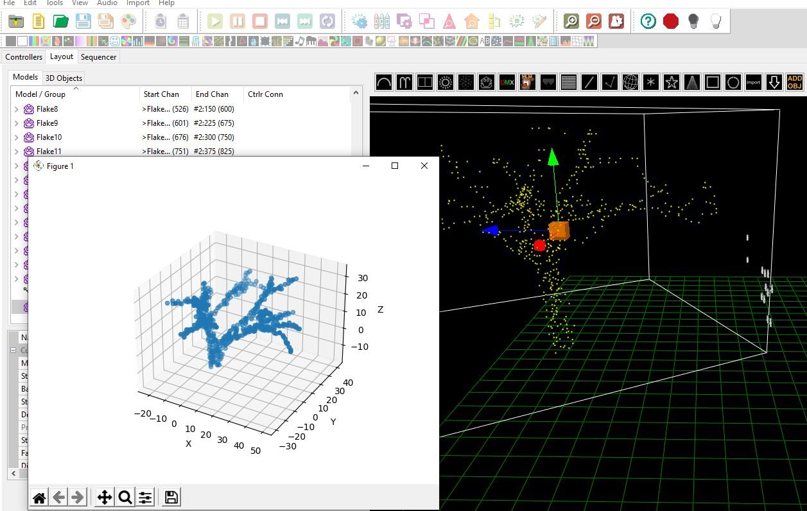

*A tree model from the original scripts in the xLights Layout tab (right). The `.xmodel` file from
the app imports the same way.*

3D model axes: X is width, Y is depth, and Z is up. The front layer of the xLights model has
the lowest Y. Camera spot 1 is on the +X side. A 2D model uses the image as the camera sees it.

### Plots

The plots need an internet connection. Without a connection, all other parts of the app work.

- **Result**: Shows the final pixel positions.
  - The color shows the pixel number. The color bar on the right shows the scale.
  - Circles show measured pixels.
  - Open diamonds show filled pixels.
  - A gray line connects the pixels in string order. A break in the line shows missing pixels.
  - Put the mouse on a point to see its pixel number.
  - In 3D, drag to turn the view. Use the mouse wheel to zoom.

  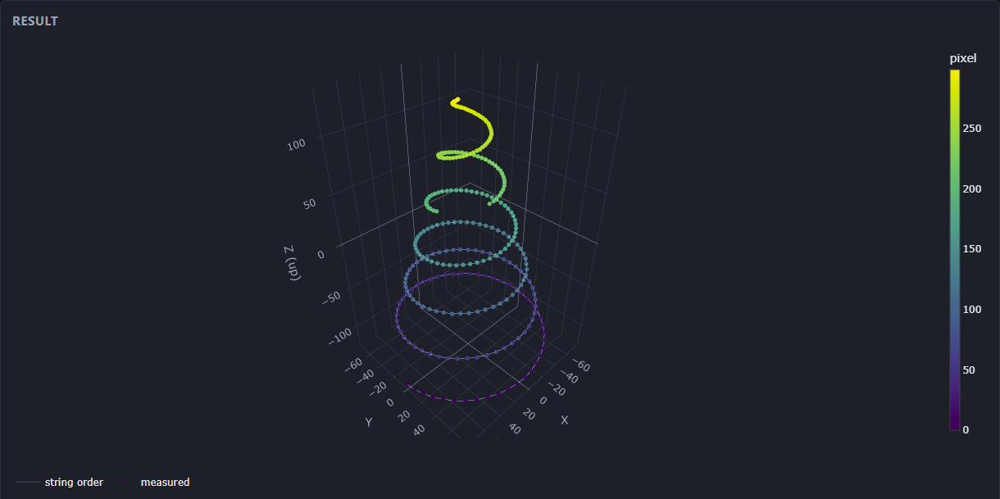

  *The 3D result of the demo tree. The pixels go up the tree in a spiral. Pixel 0 is dark
  purple at the bottom.*

- **Per-camera detections**: One plot for each camera spot. It shows the position of each
  found and manual pixel in the image. An orange X shows an ambiguous pixel. The title shows
  how many pixels the app located and how many are missing.

  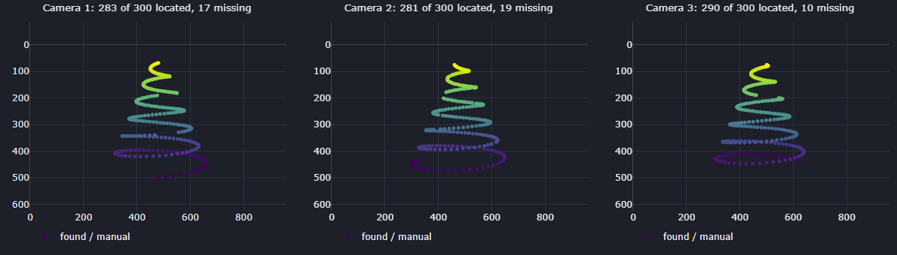

  *The pixels that each camera spot found. Each plot is the image as that camera saw it.*

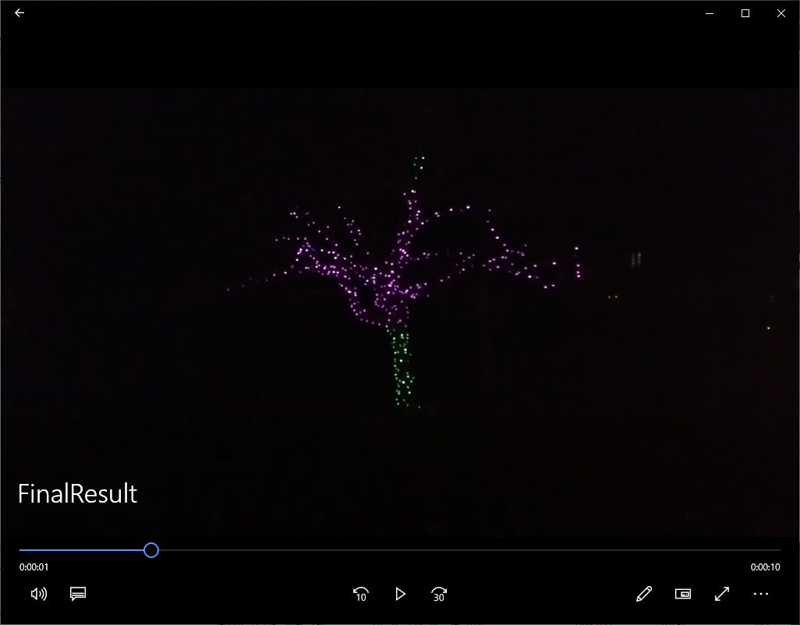

*The mapped tree with an xLights effect. [This video](images/FinalResult.mp4) shows the
effect.*

## Problems and solutions

- **The pixels do not come on.** Refer to the list on the [Lights tab](#tab-2-lights).
- **The camera does not open.** Click **Close**, then **Find USB cameras**. Use the number that
  the app finds. On Windows, close other programs that use the camera.
- **The camera image size is different from the settings.** The camera does not support that
  size. Select a size that the camera supports. Then save the settings and open the camera
  again.
- **Many pixels are not found.** On the Review tab, decrease **Min brightness rise**. Also try
  **Neighboring frames**. Then click **Run detection** again.
- **The app finds reflections or other lights.** Draw a smaller mask on the Capture tab.
  Increase **Min brightness rise**.
- **The photos show the wrong pixel.** Increase **Settle time per pixel** on the Project tab.
  Then capture again.
- **The 3D model is too tall or too short.** Make sure that the vertical FOV agrees with the
  image shape. Refer to **Camera FOV** in [Prop settings](#prop-settings).
- **The 3D model is twisted or has stray pixels.** Make sure that the camera spots go
  counter-clockwise when you look down from above. Make sure that you saved each camera spot
  on the Align tab.
- **The .xmodel file is too large.** Increase **Scale factor**, or decrease **Grid cells**.

## Project folder

```
<projects>/<project>/project.json            settings for each prop
<projects>/<project>/<prop>/cam1/            align.jpg, all_on.jpg, all_off.jpg, 0000.jpg ..., meta.json, polygon.json
<projects>/<project>/<prop>/detections/      cam1.csv: index,x,y,confidence,status
<projects>/<project>/<prop>/model/           <prop>.xmodel, points.csv, <prop>.ply, result.json
```

To move work to a different computer, copy the `<projects>/<project>` folder. The app writes
the review marks and the models into the same folder.

## Changes from the original scripts

- **Capture and detection are separate.** The Pi only takes photos. The capture does not stop
  to wait for a click.
- **Detection** compares each photo with the all-off photo, inside the mask. It uses the
  center of the brightest spot. If a second spot is 60% as bright or more, the pixel is
  ambiguous. The old full-image comparison used too much memory at approximately pixel 600.
  The new method does not have this problem.
- **Pixel numbers** continue from one universe to the next. The old formula `unum*170+index`
  was incorrect for universes that do not have 170 pixels.
- **Angle scale** comes from the yellow lines on the Align tab. The FOV is a backup value.
- **Camera pairs** with lines that cross at a small angle are not used. A pair that does not
  agree with the other two is removed. the original scripts used the average.
- **Gap fill** fills only short rows of missing pixels by default. It lists the longer rows.
- **xLights export** has these corrections:
  - The header size now agrees with the grid.
  - A point at the minimum position does not go to the other side of the grid. This was
    probably the cause of the stray points in 2024.
  - The depth layers are in the correct order. The old order made a mirror image of the model.
  - If two pixels are in the same cell, the app moves one pixel to the nearest free cell.
  - The model does not include pixels without a position. The other pixels keep their correct
    channels.
- **sACN**: The app sends the light data itself. Lumos is not necessary.

## Tests and demo

```bash
python -m unittest discover -s tests -t .
python -m tests.make_demo C:/temp/pm_demo     # synthetic three-camera tree, no hardware needed
python run.py --projects C:/temp/pm_demo
```

The tests check the sACN data, the 3D calculation, the gap fill, the detection, the capture
(with a simulated camera and lights), the xLights grid, and a full run from photos to model.
The demo uses universes and a controller address that are not in use. Thus, it cannot turn on
real pixels.

## Limits

- The app supports USB (UVC) webcams and network stream addresses only. It does not support
  the Raspberry Pi camera module.
- For a 3D prop, the camera spots must make a triangle with three equal sides.
- The app does not correct lens distortion.
